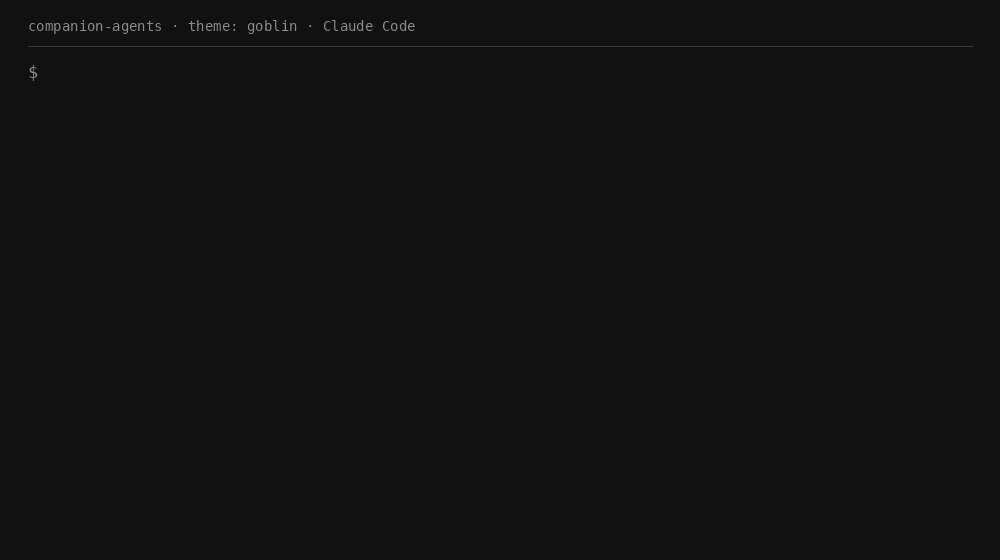

<div align="center">

# companion-agents 🎭

**Your AI agents, but make it fun.**

One hands-on companion that plans, builds, tests, and commits with you,
in the voice of a character you pick.

[](LICENSE)
[](https://github.com/las-pinter/companion-agents/actions/workflows/ci.yml)
[](https://github.com/las-pinter/companion-agents/releases/latest)
<br>
[](#-install-on-claude-code)
[](#-install-on-pi)
[](#-install-on-kiro-cli)


<sub>Scripted illustration of the eight themes. Real output varies by model and run.</sub>

</div>

Tired of AI agents with all the personality of a loading spinner? Same.
`companion-agents` gives you one **companion** that does the whole job with
you, from one shared content tree on three harnesses:
[Claude Code](https://claude.com/claude-code), [Pi](https://pi.dev), and
[Kiro CLI](https://kiro.dev). Because AI-assisted development shouldn't feel
like filing taxes.

> ⚠️ **Work in Progress** — This repo is actively evolving. The companion, the
> personas, and the skills will change, grow, and occasionally break things.
> You have been warned.

## 🧙 The Companions

| Theme | Companion | Description |
| --- | --- | --- |
| `goblin` (default) | **Bossnik** | Fierce Goblin Chief, fanatically loyal to the Evil Wizard (you). The horde ran off, so he builds the trap himself |
| `wh40k` | **Magos Omicron-Delta-9-Archaeon** | Technoarchaeologist. Sarcastic, hyper-precise (87.3333...%), performs every rite personally |
| `wh40kOrk` | **WARBOSS GRIMGOB** | **DA BIGGEST AN' DA BOSS!** Da boyz is gone, so 'e digs 'is own trenches. WAAAGH! |
| `pub` | **Seamus O'Shaun** | The Landlord — runs the whole pub single-handed, has been "quality testing" the ale since noon |
| `caveman` | **Zhen** | The Core — builds with minimum words. Maximum signal, zero noise *(inspired by [JuliusBrussee/caveman](https://github.com/JuliusBrussee/caveman))* |
| `cyberpunk` | **Zero Cool** | The BEST hacker on the west coast. Sunglasses indoors. Runs the whole job solo. "We're in." |
| `catcrew` | **Chairman Meow** | Sits on keyboard. Types with paws. Demands treats. Takes credit for everything — and now deserves it |
| `fantasy` | **The Quest Giver** | Left the town square to go on the QUESTS himself. Speaks in CAPITAL LETTERS |

The persona sets the voice in chat only. Code, commits, notes, and session logs
stay persona-free.

## 💡 Why one companion?

Earlier versions ran a crew: an orchestrator that handed every task to a
planner, an implementer, a tester, and a reviewer. Every hand-off cost a cold
start and a lossy summary, and the agent that knew the plan never saw the code.
The companion does the work itself, in one context. It keeps the plan in that
context *and* on disk, so when the facts change it changes the plan on the spot.
Profession knowledge lives in skills it loads when it needs them. Only the
independent review still runs in a separate context, because a fresh pair of
eyes is the point of a review.

- 🗺️ **Plans first** — an interview and a study you accept before any code.
- 🔨 **Builds and tests itself** — one context, no lossy hand-offs.
- 🔍 **Independent review** — a read-only reviewer in a separate context.
- 📜 **Remembers** — project notes, task notes, and session logs on disk that
  survive compaction and new sessions.
- 🛡️ **Asks before it publishes** — commits run freely; a push, a pull request,
  or a release asks you.

## 🚀 Quick start

```bash
# Claude Code
claude plugin marketplace add las-pinter/companion-agents
claude plugin install companion-agents@companion-agents --config theme=goblin
claude --agent companion-agents:companion

# Pi
pi install https://github.com/las-pinter/companion-agents
pi --agent companion-agents:companion --persona goblin

# Kiro CLI
git clone https://github.com/las-pinter/companion-agents.git ~/companion-agents
~/companion-agents/install.sh --kiro --theme goblin
kiro-cli --agent ca-companion
```

The sections below hold the prerequisites, the recommended Claude Code
settings, and the update steps for each harness.

## 📦 Install

### Prerequisites

Pick one harness or several; each installs on its own.

- **All harnesses:** Node.js (the minimum is `engines.node` in
  `package.json`) for the hooks and scripts, and git.
- **Claude Code:** `jq`, for the settings merge in `install.sh`.
- **Pi:** nothing more.
- **Kiro CLI:** version 3.4.0 or newer.

### 🟠 Install on Claude Code

<details>
<summary>Plugin, recommended settings, start, update</summary>

```bash
claude plugin marketplace add las-pinter/companion-agents
claude plugin install companion-agents@companion-agents --config theme=goblin
```

Then merge the recommended settings into your user `settings.json`:

```bash
git clone https://github.com/las-pinter/companion-agents.git ~/companion-agents  # or git pull in an existing clone
~/companion-agents/install.sh --claude --dry-run   # preview
~/companion-agents/install.sh --claude
```

> **Review `install.sh` before you run it.** It changes
> `~/.claude/settings.json` (or `$CLAUDE_CONFIG_DIR/settings.json`) and keeps a
> `settings.json.bak-<timestamp>` copy. It keeps every existing key.

The settings snippet ([platforms/claude/settings/recommended.json](platforms/claude/settings/recommended.json))
does three things:

- sets auto-compaction to start at 40% of the context window;
- gives Claude Code access to `~/agent-notes`, where the notes and session logs live;
- asks before `git push` and the write actions of `gh pr`, `gh run`, and
  `gh release`; their read actions (`view`, `list` / `ls`, `status`, `diff`,
  `checks`, `search`) pass.

Start the companion:

```bash
claude --agent companion-agents:companion
```

Change the theme any time in `/config` (**Persona theme**). A new session or
`/clear` picks it up.

Update with `claude plugin marketplace update companion-agents`, then
`claude plugin update companion-agents@companion-agents`, and restart. When a
release changes the settings snippet or `install.sh`, also run `git pull` and
`./install.sh --claude` in the clone.

</details>

### 🔵 Install on Pi

<details>
<summary>Package, persona flag, permissions, update</summary>

The same content runs on [Pi](https://pi.dev) through the adapter in
[platforms/pi/](platforms/pi/README.md). Pi needs no settings merge: the
extension carries its own permission gate.

```bash
pi install https://github.com/las-pinter/companion-agents
pi --agent companion-agents:companion --persona goblin
```

- `--agent` selects the agent. Without it, Pi adds no prompt sections and no
  gate; the commands and tools are registered but refuse to run.
- `--persona <theme>` picks the theme; `/persona <theme>` changes it in a
  running session, and `/persona` alone lists the themes.
- `/permissions` lists the effective rules with their source, `check` explains
  why one command would be allowed, asked, or denied, and `allow|ask|deny`
  appends a rule to the policy file. When Pi asks, the dialog can add the rule
  for you: this session, this project, or every project.

Policy lives in `~/.pi/agent/companion-agents/policy.json`, and per repository in
`.pi/companion-agents/policy.json` (read only when Pi trusts the project). A
built-in floor (credentials, destructive
commands, writes to git hooks and the gate's own files) cannot be loosened from
either file.

Update with `pi update --extensions`, then start a new session so the
extension reloads.

</details>

### 🟣 Install on Kiro CLI

<details>
<summary>Installer, theme, agents, gate, update</summary>

The same content runs on [Kiro CLI](https://kiro.dev) 3.4.0 or newer through
the adapter in [platforms/kiro/](platforms/kiro/README.md). The installer
copies a self-contained payload, so a moved or deleted clone does not break the
install.

```bash
git clone https://github.com/las-pinter/companion-agents.git ~/companion-agents  # or git pull in an existing clone
~/companion-agents/install.sh --kiro --dry-run   # preview
~/companion-agents/install.sh --kiro --theme goblin
kiro-cli --agent ca-companion
```

- `--theme <name>` picks the persona theme; a first install defaults to
  `goblin`, and a rerun without the flag keeps the current theme. The next
  session picks it up.
- The installer writes `~/.kiro/companion-agents/`, the skills in
  `~/.kiro/skills/`, and the agents `ca-companion`, `ca-reviewer`, and
  `ca-writer`. It never changes `chat.defaultAgent`; it warns when that setting
  names an agent that does not exist.
- A skill folder it does not own stops the install; `--force` backs it up and
  replaces it.
- Update with `git pull` and `./install.sh --kiro`.

The native Kiro rules let the companion run the read-only git commands, the
test commands, and any `node` command (the adapter scripts run through node);
the gate allows a plain git command, and a publish or a git command mixed with
other work asks. An unreviewed
non-trivial commit, a push, or a pull request shows Kiro's own permission
prompt; a change of at most two files and forty changed lines counts as
trivial. The automatic session log needs an interactive exit; a headless run
gets none, so run the wrap-up skill there. The
[Kiro adapter docs](platforms/kiro/README.md) hold the hook and gate details.

</details>

## ⚙️ How the companion works



<sub>Scripted illustration. The `ai:` prefix is this repository's commit rule; in your
repository the companion follows your commit form, or asks before the first commit.</sub>

- **Session start.** A hook gives the companion its read list: the project
  rules and summary, the last three days of the project session logs, any open
  task notes, and unfinished studies.
- **Planning.** A non-trivial task goes through an interview (questions until
  every decision is settled) and a study (goal, decisions, tasks, risks,
  acceptance criteria). You accept the study before any code is written.
- **Task notes.** A task with more than a few steps gets a working file:
  the plan with step status, the decisions, and the pinned documents. The plan
  changes there first, then in the code.
- **Review.** Before a non-trivial commit, the companion runs a read-only
  reviewer in a separate context: the review skill on Claude Code
  (`/companion-agents:review`) and Kiro CLI, `/review` or the `review` tool on
  Pi. The reviewer cannot edit files or run shell writes. On Pi and Kiro CLI, a
  commit of an unreviewed non-trivial change asks first; Claude Code has no
  such commit gate.
- **Commits.** The companion commits finished tasks without a prompt. A push, a
  pull request, or a release always asks you.
- **Compaction.** Before a compaction, the adapter records the skills the
  session used, the task notes, and the pinned documents. After it, the
  companion reloads them before it continues — so the plan, the skills, and the
  key documents survive.
- **Wrap-up.** On Pi `/skill:wrap-up`, on Claude Code
  `/companion-agents:wrap-up`, on Kiro CLI `/wrap-up`; each writes this session's
  session log.
  Each session writes its own file, so parallel sessions never collide. If you
  exit without a wrap-up, a background writer creates a shorter entry for you
  (on Pi only when you quit, not on `/new` or `/resume`; on Kiro CLI only after
  an interactive exit).
- **Retro.** `/retro` on Pi and Kiro CLI, `/companion-agents:retro` on Claude
  Code: a blameless review of the session with findings and actions. It writes
  no files.
- **Visualize.** `/visualize` on Pi and Kiro CLI, `/companion-agents:visualize`
  on Claude Code: one graphic-first document about the session, saved in
  `visuals/` in the project notes. The default is a self-contained HTML
  one-pager; add `slides` or `md` for a deck or Markdown, and any text to say
  what to show (`/visualize slides the review flow`).

Notes live in `~/agent-notes/project-notes/<project>/`, where `<project>` is
the repository's folder name (shared by all its worktrees), or `common`
outside a repository.

## 🗂️ Notes folders after an update

<details>
<summary>Move notes from the old folder names (once per project)</summary>

Task notes live in `tasks/` and session logs in `session-logs/` inside each
project notes folder. Earlier releases used two other folder names, and
nothing reads those any more. First update every adapter you use (Claude
Code, Pi, Kiro CLI), so none of them writes to the old folders again. Then
move them once per project notes folder (nothing moves them for you):

```bash
cd ~/agent-notes/project-notes/<project>
mkdir -p tasks session-logs
mv -n sessions/* tasks/ && rmdir sessions             # legacy-names
mv -n journal/* session-logs/ && rmdir journal        # legacy-names
```

`mv -n` never overwrites. When an old folder is not empty afterwards, its
remaining entries have a same-named file or day folder in the new folder;
merge those by hand.

</details>

## 🧹 Uninstall

- **Claude Code:** `claude plugin uninstall companion-agents@companion-agents`.
  `install.sh` left a `settings.json.bak-<timestamp>` next to your settings;
  remove the merged entries by hand or restore that backup.
- **Pi:** `pi remove https://github.com/las-pinter/companion-agents`. The policy
  files and the decisions log stay in `~/.pi/agent/companion-agents/` until you
  delete them.
- **Kiro CLI:** in `$KIRO_HOME` (default `~/.kiro`), delete `companion-agents/`,
  the `ca-*` agent files in `agents/`, and the skill folders in `skills/` that
  hold a `.companion-agents.json` marker. The installer's `.bak-<timestamp>`
  copies can go too.

Your notes and session logs in `~/agent-notes/` are yours; no uninstall touches
them.

## 🤝 Contributing

The Claude Code adapter is in [platforms/claude/README.md](platforms/claude/README.md),
the Pi adapter in [platforms/pi/README.md](platforms/pi/README.md), and the
Kiro CLI adapter in [platforms/kiro/README.md](platforms/kiro/README.md).
The release ritual and the commit rule live in `AGENTS.md`. The steps to add a
theme, a persona, or a skill live in [docs/adding-content.md](docs/adding-content.md).
