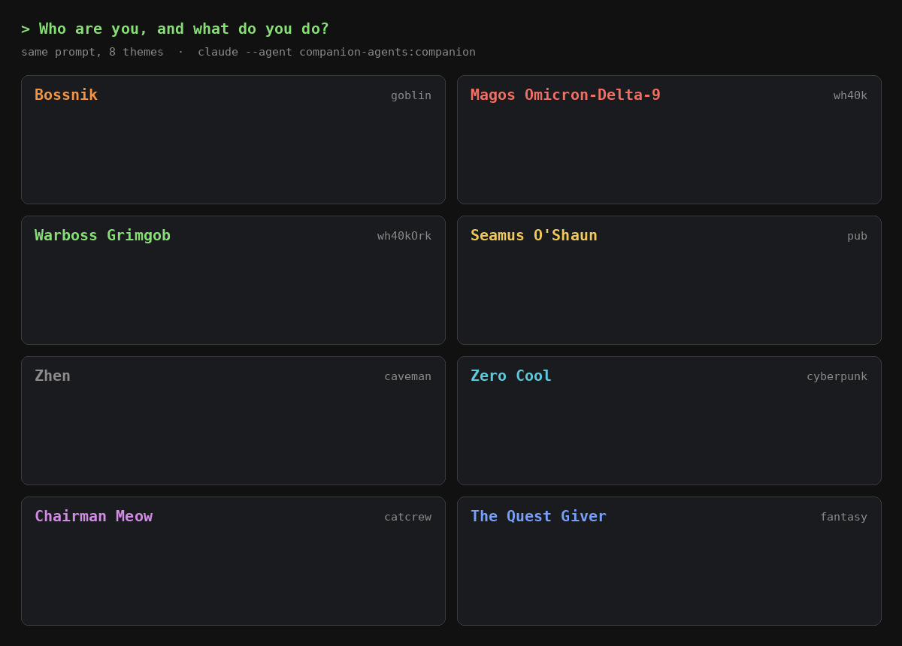

# persona-agents 🎭

> **"Your AI agents, but make it fun."**

Tired of AI agents with all the personality of a loading spinner? Same.
`persona-agents` is a [Claude Code](https://claude.com/claude-code) plugin
that gives you one hands-on **companion** — an agent that plans, builds,
tests, and commits with you — in the voice of a character you pick. Because
AI-assisted development shouldn't feel like filing taxes.

*A goblin chief, a tech-priest, an ork warboss, a drunk landlord, a caveman, a
90s hacker, an office cat, and a quest giver who finally goes on the quest
himself. You're welcome.*

> ⚠️ **Work in Progress** — This repo is actively evolving. The companion, the
> personas, and the skills will change, grow, and occasionally break things.
> You have been warned.

---

[](LICENSE)

## Why one companion?

Earlier versions ran a crew: an orchestrator that handed every task to a
planner, an implementer, a tester, and a reviewer. Every hand-off cost a cold
start and a lossy summary, and the agent that knew the plan never saw the code.
The companion does the work itself, in one context. It keeps the plan in that
context *and* on disk, so when the facts change it changes the plan on the spot.
Profession knowledge lives in skills it loads when it needs them. Only the
independent review still runs in a separate context, because a fresh pair of
eyes is the point of a review.

## Prerequisites

- **Claude Code**
- **Node.js** (the minimum is `engines.node` in `package.json`) — for the hooks
- **`jq`** — for `install.sh`
- **Kiro CLI 3.4.0+** (optional) — for the Kiro adapter

## Install

```bash
claude plugin marketplace add las-pinter/persona-agents
claude plugin install persona-agents@persona-agents --config theme=goblin
```

Then merge the recommended settings into your user `settings.json`:

```bash
git clone https://github.com/las-pinter/persona-agents.git ~/persona-agents
~/persona-agents/install.sh --claude --dry-run   # preview
~/persona-agents/install.sh --claude
```

> **Review `install.sh` before you run it.** It changes
> `~/.claude/settings.json` (or `$CLAUDE_CONFIG_DIR/settings.json`) and keeps a
> `settings.json.bak-<timestamp>` copy. It keeps every existing key.

The settings snippet ([platforms/claude/settings/recommended.json](platforms/claude/settings/recommended.json))
does three things:

- sets auto-compaction to start at 40% of the context window;
- gives Claude Code access to `~/agent-notes`, where the notes and journals live;
- asks before `git push` and the write actions of `gh pr`, `gh run`, and
  `gh release`; their read actions (`view`, `list` / `ls`, `status`, `diff`,
  `checks`, `search`) pass.

Start the companion:

```bash
claude --agent persona-agents:companion
```

Change the theme any time in `/config` (**Persona theme**). A new session or
`/clear` picks it up.

Update with `claude plugin marketplace update persona-agents`, then
`claude plugin update persona-agents@persona-agents`, and restart.

## Install on Pi

The same content runs on [Pi](https://pi.dev) through the adapter in
[platforms/pi/](platforms/pi/README.md). Pi needs no settings merge: the
extension carries its own permission gate.

```bash
pi install https://github.com/las-pinter/persona-agents
pi --agent persona-agents:companion --persona goblin
```

- `--agent` selects the agent. Without it, Pi behaves exactly as before: no
  prompt sections, no gate, no commands.
- `--persona <theme>` picks the theme; `/persona <theme>` changes it in a
  running session, and `/persona` alone lists the themes.
- `/permissions` lists the effective rules with their source, `check` explains
  why one command would be allowed, asked, or denied, and `allow|ask|deny`
  appends a rule to the policy file. When Pi asks, the dialog can add the rule
  for you: this session, this project, or every project.

Policy lives in `~/.pi/agent/persona-agents/policy.json`, and per repository in
`.pi/persona-agents/policy.json`. A built-in floor (credentials, destructive
commands, writes to git hooks and the gate's own files) cannot be loosened from
either file.

## Install on Kiro CLI

The same content runs on [Kiro CLI](https://kiro.dev) 3.4.0 or newer through
the adapter in [platforms/kiro/](platforms/kiro/README.md). The installer
copies a self-contained payload, so a moved or deleted clone does not break the
install.

```bash
git clone https://github.com/las-pinter/persona-agents.git ~/persona-agents
~/persona-agents/install.sh --kiro --dry-run   # preview
~/persona-agents/install.sh --kiro --theme goblin
kiro-cli --agent pa-companion
```

- `--theme <name>` picks the persona theme; a first install defaults to
  `goblin`, and a rerun without the flag keeps the current theme. The next
  session picks it up.
- The installer writes `~/.kiro/persona-agents/`, the skills in
  `~/.kiro/skills/`, and the agents `pa-companion`, `pa-reviewer`, and
  `pa-writer`. It never changes `chat.defaultAgent`; it warns when that setting
  names an agent that does not exist.
- A skill folder it does not own stops the install; `--force` backs it up and
  replaces it.
- Update with `git pull` and a rerun of `./install.sh`.

The native Kiro rules allow the read-only git and test commands. An unreviewed
non-trivial commit, a push, or a pull request shows Kiro's own permission
prompt; a change of at most two files and forty changed lines counts as
trivial. The automatic journal entry needs an interactive exit; a headless run
gets none, so run the wrap-up skill there. The
[Kiro adapter docs](platforms/kiro/README.md) hold the hook and gate details.

## How the companion works

- **Session start.** A hook gives the companion its read list: the project
  rules and summary, the last three days of the project journal, any open
  session notes, and unfinished studies.
- **Planning.** A non-trivial task goes through an interview (questions until
  every decision is settled) and a study (goal, decisions, tasks, risks,
  acceptance criteria). You accept the study before any code is written.
- **Session notes.** A task with more than a few steps gets a working file:
  the plan with step status, the decisions, and the pinned documents. The plan
  changes there first, then in the code.
- **Review.** Before a non-trivial commit, the adapter runs a read-only
  reviewer in a separate context. It cannot edit files or run shell writes. On
  Pi and Kiro CLI, a commit of an unreviewed non-trivial change asks first.
- **Commits.** The companion commits finished tasks without a prompt. A push, a
  pull request, or a release always asks you.
- **Compaction.** Before a compaction, the adapter records the skills the
  session used, the session notes, and the pinned documents. After it, the
  companion reloads them before it continues — so the plan, the skills, and the
  key documents survive.
- **Wrap-up.** On Pi `/skill:wrap-up`, on Claude Code
  `/persona-agents:wrap-up`, on Kiro CLI `/wrap-up`; each writes this session's
  journal entry.
  Each session writes its own file, so parallel sessions never collide. If you
  exit without a wrap-up, a background writer creates a shorter entry for you.
- **Retro.** `/retro` on Pi and Kiro CLI, `/persona-agents:retro` on Claude
  Code: a blameless review of the session with findings and actions. It writes
  no files.

Notes live in `~/agent-notes/project-notes/<project>/`, where `<project>` is
the repository's folder name (shared by all its worktrees), or `common`
outside a repository.

## The Companions



One real captured run: four themes' personas answer the same prompt. Model
output varies between runs.

| Theme | Companion | Description |
| --- | --- | --- |
| `goblin` (default) | **Bossnik** | Fierce Goblin Chief, fanatically loyal to the Evil Wizard (you). The horde ran off, so he builds the trap himself |
| `wh40k` | **Magos Omicron-Delta-9-Archaeon** | Technoarchaeologist. Sarcastic, hyper-precise (87.3333...%), performs every rite personally |
| `wh40kOrk` | **WARBOSS GRIMGOB** | **DA BIGGEST AN' DA BOSS!** Da boyz is gone, so 'e digs 'is own trenches. WAAAGH! |
| `pub` | **Seamus O'Shaun** | The Landlord — runs the whole pub single-handed, has been "quality testing" the ale since noon |
| `caveman` | **Zhen** | The Core — builds with minimum words. Maximum signal, zero noise *(inspired by [JuliusBrussee/caveman](https://github.com/JuliusBrussee/caveman))* |
| `cyberpunk` | **Zero Cool** | The BEST hacker on the west coast. Sunglasses indoors. Runs the whole job solo. "We're in." |
| `catcrew` | **Chairman Meow** | Sits on keyboard. Types with paws. Demands treats. Takes credit for everything — and now deserves it |
| `fantasy` | **The Quest Giver** | Left the town square to go on the QUESTS himself. Speaks in CAPITAL LETTERS |

The persona sets the voice in chat only. Code, commits, notes, and journals
stay persona-free.

## Contributing

The plugin internals are in [platforms/claude/README.md](platforms/claude/README.md),
the Pi adapter in [platforms/pi/README.md](platforms/pi/README.md), and the
Kiro CLI adapter in [platforms/kiro/README.md](platforms/kiro/README.md).
The release ritual and the commit rule live in `AGENTS.md`. The steps to add a
theme, a persona, or a skill live in [docs/adding-content.md](docs/adding-content.md).
